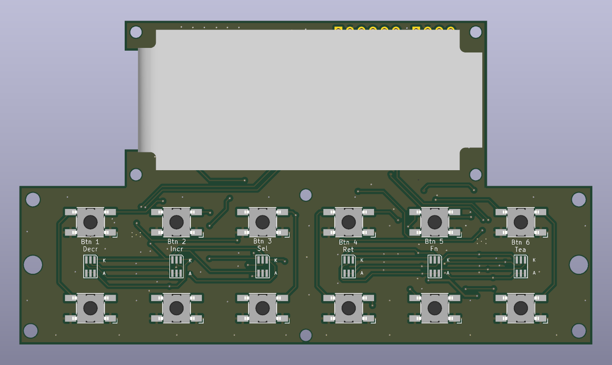
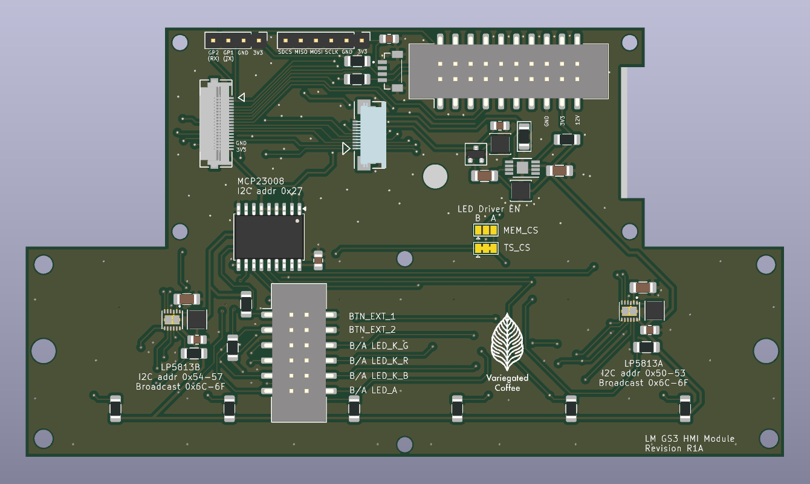

# LM GS3 HMI Module

*Front (the PCB's bottom side): the display bracket, the six buttons with two switches each, and the RGB LEDs between them. The display itself isn't modelled.*

*Back (the PCB's top side): the connectors, the LED and backlight drivers and the MCP23008. Both rendered in KiCad from the R1A design files.*

Espresso electronics are usually proprietary affairs with little to no expandability. The purpose of this project is to give everyone an open source alternative with lots of features and flexibility.

This board is the display and button module for the APEC carrier board for the La Marzocco GS3 (`apec-carrier-lm-gs3`), which is built around the [APEC SoM](https://github.com/variegated-coffee/apec-som). It carries a TFT display, six backlit buttons and their drivers, and connects to the carrier with a single cable.

This project isn't affiliated with or endorsed by La Marzocco. "La Marzocco" and "GS3" are used only to say which machine the module is designed for.

## High-level features

* 2.79" 142×428 IPS TFT display ([BuyDisplay](https://www.buydisplay.com/wide-angle-2-79-inch-142x428-color-ips-tft-display-nv3007-controller), NV3007 controller) on a 10-pin FFC connector (J2), driven over SPI
* Display backlight driver (U1, TI LM3410) set to about 76 mA, dimmable by PWM from the carrier
* Six buttons (Decr, Incr, Sel, Ret, Fn, Tea), each with two tactile switches (Omron B3FS-1050P in the BOM, or the cheaper E-Switch TL3301TF100QG), read through an MCP23008 I2C I/O expander (U2) with an interrupt line to the carrier
* Six RGB LEDs, one per button, driven by two TI LP5813 LED drivers (U4, U5) with built-in boost converters
* Header J4 for two external buttons and two external RGB LEDs
* Connects to the carrier with a 2×10 IDC ribbon cable (J13, the same pinout as the carrier's J13), which is what you'd use in a GS3, or an 18-pin EyeSPI FFC cable (J12), which is handier on the bench. It runs from the carrier's 3.3 V supply alone.
* Qwiic connector (J3) to extend the I2C bus
* A 3D-printed display bracket ([`GS3 TFT Shim.stl`](GS3%20TFT%20Shim.stl)) that holds the display in the right position

[ENGINEERING-NOTES.md](ENGINEERING-NOTES.md) has the details, [IO.md](IO.md) the signal and I2C assignments, and [MANUFACTURING-NOTES.md](MANUFACTURING-NOTES.md) how to build one.

## Project status

The current revision is R1A. It hasn't been manufactured yet; EV1 is the most recent revision that has been built. [CHANGELOG.md](CHANGELOG.md) lists what changed between them, including the changes firmware has to follow.

The firmware is developed separately.

## Safety

The module itself only uses 3.3 V from the carrier, but it is installed in an espresso machine, together with a carrier board that switches mains voltage, next to high-pressure hot water and steam. Read the carrier's safety warning before working on the machine, and never connect or disconnect the module while the machine is plugged in.

## Notice

This repository contains design files only. It is not a finished product, and it has not been tested or certified for compliance with any regulation, including but not limited to CE, UKCA or FCC requirements.

Anyone who manufactures, assembles, or places a product based on these files on the market does so as the manufacturer of that product, and is solely responsible for its safety, conformity assessment, marking, documentation, and any legal obligations that follow. If you build or use it yourself, you do so at your own risk.

The designs are provided “as is” under the CERN-OHL-P v2. See sections 5.1 and 5.2 for the disclaimer of warranty and limitation of liability.

## Opening the design

The project is made with KiCad 10. Every library the design needs is either in this repository or a KiCad standard library, so it opens without extra setup. A few parts exist only as copies embedded in the schematic and PCB, because their library files can't be redistributed. KiCad reports their libraries as missing, which is expected. See [THIRD_PARTY.md](THIRD_PARTY.md).

Vendor 3D models aren't included either. [3d-models/README.md](3d-models/README.md) lists where to download them for complete 3D views.

Parts of the schematic lie outside the A4 sheet frame. They are part of the design; zoom out to see them. A plot of the sheet (PDF or SVG) only shows what is inside the frame.

## License

The design files and documentation in this repository are licensed under the CERN Open Hardware Licence Version 2 – Permissive (CERN-OHL-P-2.0); see [LICENSE.txt](LICENSE.txt).

Some library files come from third parties and keep their own licences; see [THIRD_PARTY.md](THIRD_PARTY.md).
